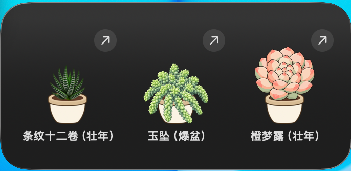
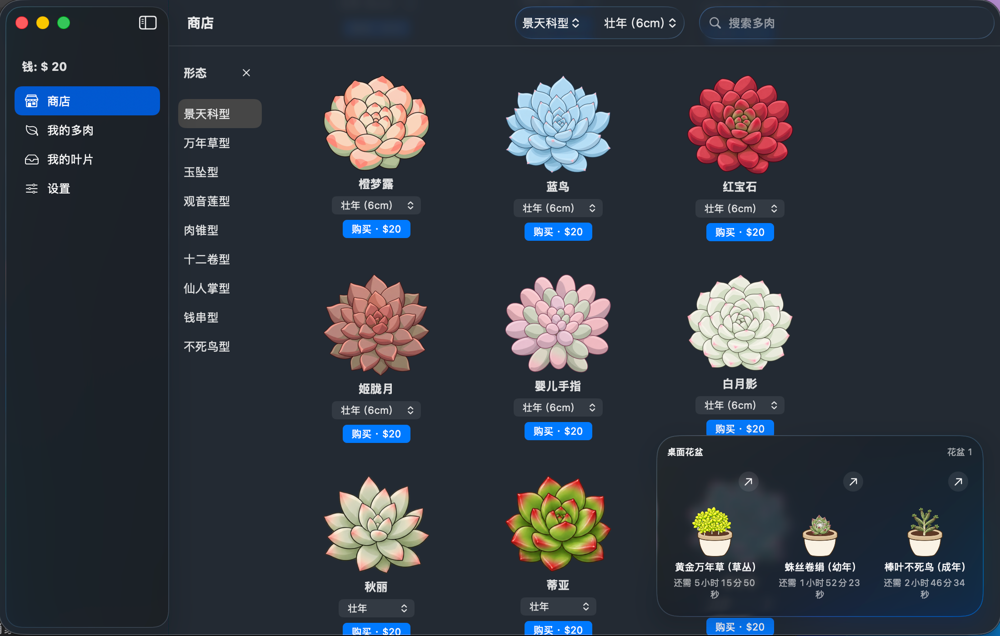
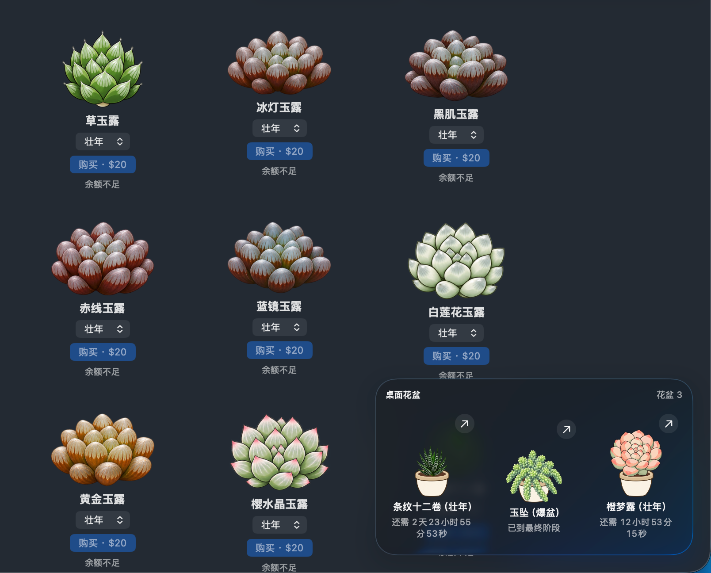
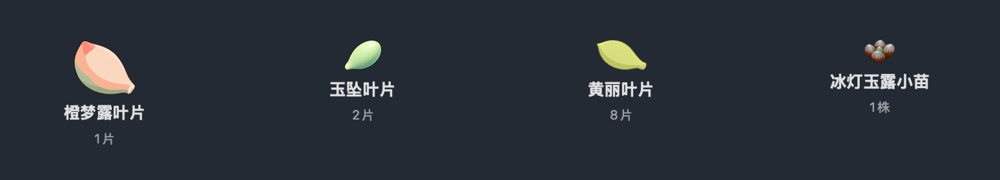

# SucculentGarden · 多肉花园

把会长大的多肉养在 Mac 桌面上。电脑负责长肉，你负责欣赏，以及别把零钱花光。

这里有 **115 个品种、9 种形态**。从一片叶、一根枝或一颗种子开始，慢慢养成一盆；也可以在商店直接买个大户。暂时不用浇水、不用补光——现实里的多肉已经够考验人类了，桌面这盆先放你一马。

顺便附赠一个木鱼球：点一下，功德 +1，福缘随机 +1～3。多肉在长，功德也在长，工作进度请自行负责。

## 怎么玩

1. **先领材料。** 开局有 **$10**，每天可免费领取 **5 份**叶片、枝条、小苗等繁殖材料，所有品种共享额度；也能花钱直接买多肉，买完先进入“我的多肉”，再自己摆进花盆。
2. **种进花盆。** 把“我的叶片”中的卡片拖进主页面右下角的花盆，一次只用一份；已有植株可以摆放、拖动换盆；盆内植株仍在收藏中，底部标注“盆栽1／2／3”并排在最前面。
3. **等它长大。** 多肉随自然时间进阶，设置里可以调速。养大后出售换钱，允许拆分的植株还能拆成材料继续繁殖——桌面上的小生意，不交房租。
4. **搬上桌面。** 小号组件显示一盆，中号显示三盆；点每盆右上角的箭头，回到主页面管理。进度自动保存，关掉应用后仍按经过的时间计算成长。

当前版本：**1.9（45）**。

## 花园长这样

桌面组件：小号一盆，中号三盆，点箭头就能回到花园管理。



商店里挑多肉、选生长时期，右下角就是你的三只花盆。



玉露的窗也有透光感，电脑屏幕就是它们的阳台。



繁殖材料按品种集合，数量写在第二行，每次拖放只取一份。



## 最近长了点什么

- **玉露把窗户擦亮了。** 11种软玉露的五个时期恢复清透窗面，内部叶纹、透光层次和各自的底色更清楚；小苗仍是小苗，老桩仍是单头。
- **花园扩招43位。** 花月夜、雪域、超奶品相泡芙、粉霜系紫水晶、四种配色熊童子、金枝玉叶、佛珠、姬玉露、鹰爪、四种彩色生石花等加入；已有品种不会重复开店。熊童子的紫／黄／粉／蓝为游戏配色，现实中的熊不必去染头发。
- **兔子与蝴蝶都长在叶子上。** 碧光环成年起多头，靠种子繁殖；蝴蝶不死鸟成年起带粉色叶缘小芽，沿用不死鸟的领取、拆分和24小时摘芽规则。
- **长指叶层层叠，窗户也有各自的颜色。** 千佛手保留长指叶、密集增层并缓慢长高；奶酪变成粉白圆叶。条纹十二卷成年起放大，侧芽向外斜生；冰灯与黑肌最透亮，水晶寿/月影寿改成三角窗，其他玉露各有自己的底色。白月影继续当它的紧凑小包子。
- **五十铃玉来报到。** 棒状厚叶顶着透光小窗，按游戏分类加入十二卷型；从小苗到老桩有五期，小苗免费领，共享每日5次额度，各期不能拆叶。小小一丛，窗户倒不少。
- **操作有回音。** 购买、领取、种植、换盆、出售、拆分和倍率应用后会显示短暂横幅；叶片右键可种入指定花盆、丢弃一份或丢弃当前品种整叠，领取次数不会返还。
- **买回家，先挑位置。** 新买的多肉留在收藏，盆内植株也一起显示，带“盆栽N”标识的排在前面。换盆会移动标识，原住民回到未摆放队伍，不会凭空消失。

- **奶酪、特玉莲、汤圆报到。** 三种新品种都有叶片与六个生长时期；特玉莲保留反卷叶的特殊长相。三种群生采用紧密簇状，侧芽向不同方向斜出、相互遮挡。千佛手也在店里，老员工不用重新办理入职。
- **卡片不再占着空白发呆。** 商店、收藏和叶片页按图片实际高度排布，同行以最高卡片为准；小叶片少占地，大老桩有空间。
- **桌面预览挪到右下角。** 主页面的三盆收成一个紧凑玻璃区域，显示名称、时期和成长倒计时。拖叶片进去种植，拖多肉换盆，点箭头选择对应花盆。
- **叶片会集合了。** “我的叶片”按品种合并成一张卡，第二行显示数量，枝条、小苗、种子、芽块也各用自己的单位。拖一次只用一份，最后一份种完才移除卡片——一叠叶子不会一拖就全下锅。

## 快速入手：让 Codex 当园丁

先准备一台 **macOS 26 或以上**的 Mac，安装完整 Xcode，首次打开完成必要的许可与组件安装。只有 Command Line Tools 还不足以构建这个 Widget 工程。

打开 Codex 的本地任务，把**仓库链接或本地文件夹路径**填进下面的提示词，直接发给它：

```text
请把 SucculentGarden 部署到这台 Mac。

仓库地址：git@github.com:xiao-Huahuo/SucculentGarden.git
（如已下载到本地，也可改为该文件夹的完整路径。）

如果给的是 URL，请先克隆到本地；如果给的是路径，直接使用该目录。
先阅读 AGENTS.md / CLAUDE.md 和开发规范.md，再检查 Xcode、macOS SDK、
XcodeGen、Apple Development 签名身份和 App Group 配置。

请完成工程生成、Release 构建、签名验证、安装、Widget 登记和运行检查。
把应用安装到 ~/Applications/多肉花园.app，保留已有存档、Bundle ID、
Widget kind 和用户设置；升级时按需要重启相关进程或系统服务，并核对恢复情况。
原路径升级应刷新正式应用登记，不要先注销正在使用的正式应用，
否则系统可能把已放在桌面的组件当作卸载而移除。

首次在另一台 Mac 配置签名时，请统一使用我的 Team 和可用的 App Group，
同步 project.yml 与 Services/SucculentStore.swift 中的 groupID。
不要把作者的 Team ID 当成我的签名身份。

能自行完成的步骤请继续做；确需我登录 Apple 账号、授权钥匙串，
或工具无法操作“编辑小组件”时，再告诉我最短的操作步骤。
最后报告安装位置、验证结果和仍需我确认的项目。
```

一句话版也行：**“仓库在这里，读完开发规范，帮我构建并部署到 Mac 桌面，保留原数据。”**

Codex 可以检查环境、改签名配置、编译、安装和核对数据。本人账号登录、验证码、必要的系统授权，以及工具碰不到的桌面入口，仍可能需要你点几下。园丁可以代劳，Apple 账号还是你的。

仓库：[xiao-Huahuo/SucculentGarden](https://github.com/xiao-Huahuo/SucculentGarden)。已下载源码时，也可直接把本地目录交给 Codex，不必重复克隆。

## 快速入手：自己动手

### 1. 拿到工程，打开 Xcode

下载或克隆 [源码](https://github.com/xiao-Huahuo/SucculentGarden)，进入项目根目录。安装 [XcodeGen](https://github.com/yonaskolb/XcodeGen#installing)，用于从 `project.yml` 生成工程；已有 Homebrew 的话：

```bash
brew install xcodegen
xcodegen generate
open SucculentGarden.xcodeproj
```

当前最低系统为 macOS 26，需要能提供 macOS 26 SDK 的完整 Xcode。本机使用 Xcode 27 验证。

### 2. 给花园办一张身份证

仓库自带的是作者的签名配置。**首次在自己的 Mac 上构建**，需要先准备 Apple Development 签名身份，并统一修改：

| 位置 | 要改的内容 |
| --- | --- |
| `project.yml` | `DEVELOPMENT_TEAM` 换成自己的 Team ID |
| `project.yml` 的两个 target | App Group 都换成自己可用的同一个组 |
| `Services/SucculentStore.swift` | `groupID` 与上面的 App Group 完全一致 |

木鱼和花园存储共用这一个 `groupID`。在 Xcode 的 **Signing & Capabilities** 中核对主应用和扩展都选了正确 Team、同一个 App Group；如需登录或创建证书，在 Xcode 设置的 Apple Accounts 中完成。

修改 `project.yml` 后再运行 `xcodegen generate`。只在生成的 Xcode 工程里改设置，下次重新生成可能会把它盖掉——园丁记性很好，生成器的记性更好。

已有安装升级时沿用原 Team、共享组和标识，别给同一盆肉换一个存档地址。

### 3. 构建并安装

在项目根目录执行：

```bash
xcodebuild -project SucculentGarden.xcodeproj \
  -scheme SucculentGarden \
  -configuration Release \
  -destination 'platform=macOS' \
  -derivedDataPath build/DerivedData build
```

成功后，应用位于：

```text
build/DerivedData/Build/Products/Release/多肉花园.app
```

把完整 `.app` 复制到 `~/Applications/多肉花园.app`，打开一次，再添加桌面组件。升级已有安装时先退出旧主应用，替换整包；如果桌面仍显示旧图，可让 Codex检查是否仍驻留旧扩展或加载了开发副本。

`.app` 就是应用；DMG 是它的搬家纸箱。本项目目前提供本机开发签名安装，下载一份源码不等于已经完成公证分发。

### 4. 把花园搬到桌面

桌面空白处右键 → **编辑小组件** → **SucculentGarden**，选择：

- **多肉花园**：小号一盆，中号三盆。小号可以配置显示哪个花盆。
- **木鱼球**：点图标敲一下，时钟、功德、福缘和每日箴言一起待在桌面。

多肉下方显示“名称（阶段）”；每盆右上角的箭头会打开主页面对应花盆。摆在哪里你说了算，电脑右上角并没有更好的风水加成。

如果刚更新后编辑面板还显示旧名字，先关闭再打开面板；仍旧不对时检查实际安装副本与系统登记，不必急着删除存档或重启整台 Mac。

## 开始养肉

1. **先领材料。** 商店切到初始阶段，领取叶片、枝条、小苗、种子或芽块。所有品种共享每天 **5 次**免费额度，初始零钱 **$10**。
2. **再种进盆。** 到“我的叶片”，找到对应品种的卡片，把它拖到主页面右下角的花盆。也可以右键卡片选择“种入花盆1／2／3”。例如卡片上有9片黄丽叶，种一次后剩8片；其他品种的库存不受影响。种下才创建新植株。桌面 Widget 展示同一份盆位数据，拖放在主页面完成。
3. **等它长大。** 关闭应用后仍按经过的自然时间计算成长。右下角花盆有实时进阶倒计时；设置能调全局成长速度，也能分别调类型乘数 x 和品种乘数 y。
4. **管理收藏。** 购买的多肉先进入“我的多肉”，由你拖入花盆。盆内植株仍显示在收藏里，底部标注“盆栽1／2／3”，按盆位排在最前面；替换或换盆时标识同步转移，被替换的植株留在收藏。整张卡片都可拖动，右上角或右键菜单可以放入花盆、出售，以及在允许的时期拆分繁殖。

钱不够就先养，养大再卖；这次是虚拟零钱，盆再多也不会挤占阳台。

商店与“我的多肉”都有形态和阶段筛选。选形态时显示对应的时期名；不选形态时显示 **1～6**，选第6期会隐藏没有第6期的品种。商店统一切换商品时期，收藏按植株的实际阶段筛选。

## 花园规则，简明版

| 形态 | 品种数 | 繁殖材料与阶段 |
| --- | --- | --- |
| 景天科型 | 55 | 叶片；叶插小芽、幼年、成年、壮年、老桩、群生 |
| 万年草型 | 7 | 枝条；小草/小苗、群生、草丛/丛生、爆盆 |
| 玉坠型 | 3 | 叶片；叶插小芽加后续四期，玉坠小草还可免费领取到收藏 |
| 观音莲型 | 5 | 小苗；小苗、幼年、成年、群生、老桩 |
| 肉锥型 | 8 | 种子；种子、萌芽、幼年、成年、老桩 |
| 十二卷型 | 15 | 小苗；小苗、幼年、成年、壮年、老桩 |
| 仙人掌型 | 6 | 芽块；芽块、幼年、成年、群生、爆盆 |
| 钱串型 | 12 | 枝条；小苗、幼年、成年、老桩、多头 |
| 不死鸟型 | 4 | 小芽；小芽、幼年、成年、壮年、老桩、群生 |

这些是游戏里的**形态分类**，不是植物学考试的标准答案。

- x、y 乘的是时间：实际进阶间隔 = 基础间隔 × x × y ÷ 全局成长倍率。x/y 越大，长得越慢；它们不会偷偷把售价翻倍。
- 拆分消耗原植株，返还同种材料，不占每日免费领取次数。不同形态与时期的可拆数量不同；肉锥型不能拆，十二卷型只有玉扇、条纹十二卷保留末期分苗。
- 不死鸟成年后可以“摘芽”：保留母株，每株冷却24小时，不占商店领取额度。直接领取小芽仍占每天5次。
- 图标按成长时期绘制，群生、单头老桩、木质枝、透光窗和细毛各有各的讲究。熊童子不是绿手套，玉扇也不是绿色莲花。

## 数据与开发

存档保存在本机 App Group 的应用支持目录：花园用 `SucculentGarden/garden.json`，木鱼用 `MuyuBall/progress.json`。植株、盆位、材料、钱包和倍率原子保存；升级有格式迁移，不会把你养了几天的肉当成一次性预览。

工程、主 target、模块和 scheme 都叫 `SucculentGarden`，扩展 target 为 `SucculentGardenWidgets`。安装文件和中文主界面仍叫“多肉花园”；旧组件的内部 kind 与运行路径作为兼容标识保留，老花盆不用搬家。

- `project.yml`：构建、签名与名称的配置来源。
- `App/`、`Views/`、`Components/`：主应用与共用界面。
- `Models/`、`Services/`：规则、成长与存储。
- `Widgets/`：桌面时间线与交互。
- `Resources/`：透明图集、花盆与100句箴言。
- `Tests/`：96项隔离测试，不拿用户的花盆做实验。

需要跑测试时：

```bash
xcodebuild -project SucculentGarden.xcodeproj \
  -scheme SucculentGarden \
  -destination 'platform=macOS' \
  -derivedDataPath build/DerivedData test
```

当前115品种与207个图像资源条目都在应用里。主界面按需加载图片，窗口/Widget的图片缓存预算分别是16/8 MiB；这只是图片缓存，不是整个进程的减肥保证书。

完整规则演进、迁移与验收范围见 [变更记录](docs/change_history/README.md)，开发约定见 [开发规范](开发规范.md)。品种与生长参数的来源记录在 `references/succulents/`；ChatGPT 图标权利归 OpenAI，参见 [官方品牌说明](https://openai.com/brand/)。
